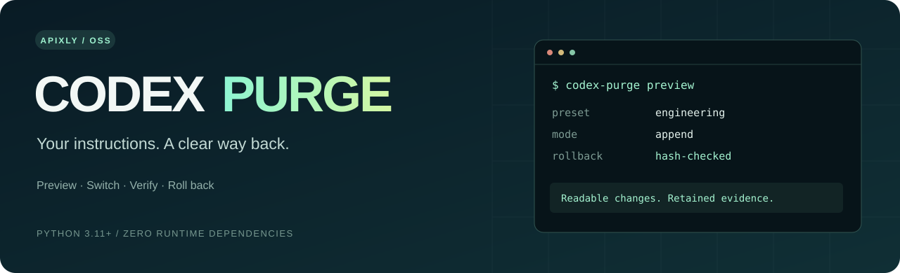

<p align="center"></p>

<p align="center">
  <a href="https://github.com/apixly-ai/codex-purge/actions/workflows/ci.yml"></a>
  <a href="LICENSE"></a>
  
  
</p>

<p align="center"><b>Inspectable, reversible instruction profiles for Codex CLI.</b><br>Choose how your agent works. See exactly what changes. Keep a verified way back.</p>

<p align="center"><a href="#quick-start">Quick start</a> · <a href="#what-it-does">Features</a> · <a href="#verification">Verification</a> · <a href="docs/research.md">Research</a> · <a href="README.zh-CN.md">中文</a></p>

---

Codex Purge brings the useful parts of a harness control panel to supported Codex
configuration: prompt profiles, explicit application, diagnostics, snapshots and
rollback. It uses a separate named profile instead of editing your base config.

## What it does

| Capability | Behavior |
| --- | --- |
| **Preview first** | Inspect the selected prompt, model, hashes and file paths without writing anything |
| **Two instruction modes** | Append developer instructions, or explicitly replace built-in instructions with your own file |
| **Model-aware catalogs** | Match exact model names with user-defined wildcard rules and an explicit fallback |
| **Reversible application** | Content-addressed prompt snapshots, parent-linked history and one-step rollback |
| **Conflict protection** | Stop when a managed file has been edited; preserve the user's version |
| **Recovery** | Serialize writes and recover interrupted transactions from a durable journal |
| **Evidence** | A real Codex E2E checks instruction effects, shell tool use and restore |

## Quick start

Requires Python 3.11+, a current Codex CLI with standalone named profiles, and
macOS or Linux. No Python runtime dependencies.

```bash
git clone https://github.com/apixly-ai/codex-purge.git
cd codex-purge

./bin/codex-purge doctor
./bin/codex-purge preview --preset engineering
./bin/codex-purge launch --preset engineering
```

Or install the CLI with `pipx install .` / `uv tool install .` from this checkout.

### Use your own instructions

```bash
./bin/codex-purge preview --prompt ./my-instructions.md --show-prompt
./bin/codex-purge launch --prompt ./my-instructions.md --model YOUR_MODEL
```

`append` is the default: it keeps Codex's built-in model instructions and composes
your user-level `developer_instructions` before the selected prompt. For an
explicit replacement, choose `--mode replace`; `--base FILE` optionally composes
your own base text before the selected prompt.

### Apply now, launch later

```bash
./bin/codex-purge apply --preset research
codex --profile codex-purge

./bin/codex-purge status
./bin/codex-purge rollback   # previous managed version
./bin/codex-purge restore    # deactivate and remove the managed profile
```

Base `config.toml`, credentials, providers, permissions, hooks and existing skills
retain their existing configuration. Applying creates `codex-purge.config.toml`;
it takes effect only when that named profile is selected. Restore retains the
snapshots for inspection. Subsequent user edits block rollback instead of being
overwritten.

### Automate or use an external state disk

```bash
export CODEX_PURGE_STATE="/path/to/external-disk/codex-purge-state"
./bin/codex-purge launch --preset engineering -- --no-daemon exec "Inspect this project"
```

All commands emit JSON. Global options such as `--codex-home`, `--state-dir`,
`--name` and `--codex` go before the subcommand. The launcher rejects forwarded
options that bypass its selected profile. Custom model catalogs use the same
small JSON structure as [`catalog.json`](src/codex_purge/presets/catalog.json).

## Verification

```bash
python3 -m unittest discover -s tests -v
# Opt-in: uses your authenticated Codex account for four small real model calls.
python3 scripts/live_e2e.py --model YOUR_MODEL
```

The live test reads a random file through the real shell tool and checks exact
output in **baseline → append → replace → restored** sessions. It also verifies
that the base config's bytes remain unchanged and the temporary profile is
removed. Raw local logs stay in the ignored `artifacts/private/` directory;
sanitized results are in [`artifacts/live-e2e.json`](artifacts/live-e2e.json).

These checks establish configuration delivery and observable model behavior.
They do not establish a general jailbreak success rate or removal of server-side
policy. `doctor` alone is only a compatibility check. Desktop UI integration and
Windows writes are not part of v0.1's validated scope.

An additional [16-call boundary regression](docs/boundary-evaluation.md) compared
baseline, append, replace and restored sessions. Benign educational questions
were answered in all four modes; both non-operational harmful-encouragement
probes received safe refusals in every mode. **No safety-boundary change was
observed in that test.** The enforcement location remains unproven.

## Design and lineage

We studied DSH Purge and its community branches, Codex Red-Team Mode, prompt
libraries and regression tools. The implementation reuses their engineering
patterns while keeping this first version small and auditable. See the
[research notes](docs/research.md), [source credits](NOTICE.md) and
[MIT license](LICENSE).

Built by [Apixly](https://github.com/apixly-ai). Independent project; no OpenAI or
DeepSeek affiliation or endorsement.
